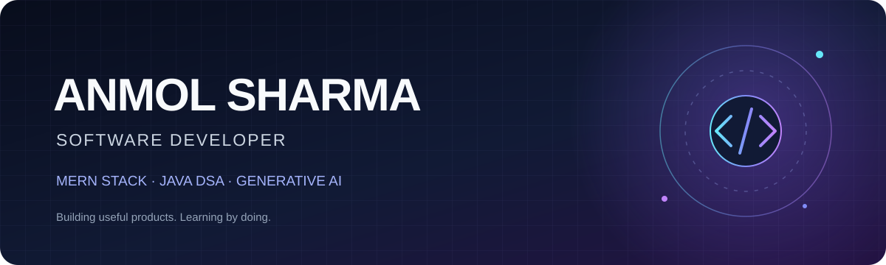

 

  

*Building useful products, solving problems, and learning by doing.*

---

## 👨‍💻 About Me

- 🌐 Building full-stack applications with the **MERN stack**
- ☕ Practising **Data Structures & Algorithms in Java**
- 🤖 Exploring **Generative AI, LLM integration, and Agentic AI**
- 🚀 Participant in the **EPAM COE program**
- 📍 Bhopal, India

## ⚡ Tech Stack

**Languages**

**Frontend**

**Backend & Database**

**Developer Tools**

## 🚀 Featured Projects

<table>
  <tr>
    <td width="50%" valign="top">
      <h3>🧠 <a href="https://github.com/anmol-sh04/AI-LifeSaver">AI LifeSaver</a></h3>
      
AI-assisted task planning and deadline tracker that helps users organize daily tasks and stay ahead of deadlines.

      
FULL-STACK · AI-ASSISTED PRODUCTIVITY

    </td>
    <td width="50%" valign="top">
      <h3>📋 EduAttend</h3>
      
Smart attendance monitoring application designed to reduce manual attendance effort and streamline college attendance management.

      
MONGODB · EXPRESS · REACT · NODE.JS

    </td>
  </tr>
  <tr>
    <td colspan="2" valign="top">
      <h3>🤖 AI-Powered Upskilling Platform &nbsp;</h3>
      
An adaptive learning platform that identifies skill gaps through assessments and guides learners with personalized learning paths. Working on backend services using Spring Boot and Node.js, with LLM-powered question generation.

      
SPRING BOOT · NODE.JS · REST APIs · LLM INTEGRATION

    </td>
  </tr>
</table>

## 📈 GitHub Analytics

---

### 🤝 Let's Connect

<a href="mailto:anmolsharma10204@gmail.com">Email</a> &nbsp;·&nbsp;
<a href="https://linkedin.com/in/anmol-sharma">LinkedIn</a> &nbsp;·&nbsp;
<a href="https://github.com/anmol-sh04">GitHub</a>

 

Thanks for visiting! ⭐ Feel free to explore my repositories.

